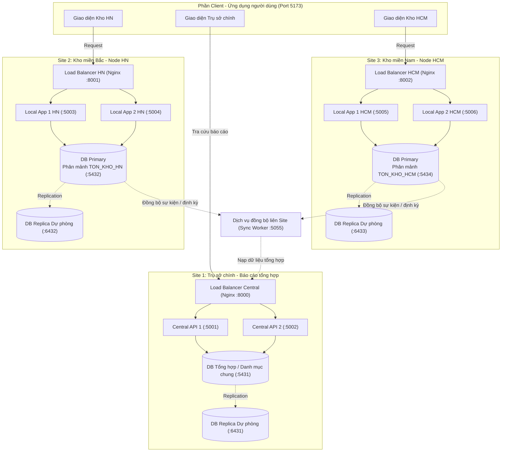

# 🏛️ TÀI LIỆU KIẾN TRÚC & HƯỚNG DẪN HỆ THỐNG QUẢN LÝ KHO PHÂN TÁN (WMS)

Hệ thống được thiết kế và triển khai chính xác theo **Sơ đồ kiến trúc phân tán 3 Site**:
* **Site 1: Trụ sở chính - Báo cáo tổng hợp** (Quản lý Master Data, Báo cáo BI toàn quốc)
* **Site 2: Kho miền Bắc - Node HN** (Phân mảnh dữ liệu `TON_KHO_HN`)
* **Site 3: Kho miền Nam - Node HCM** (Phân mảnh dữ liệu `TON_KHO_HCM`)

---

## 📐 1. SƠ ĐỒ KIẾN TRÚC TỔNG THỂ



---

## 🌟 2. CÁC TÍNH CHẤT PHÂN TÁN ĐÃ ĐƯỢC CẢI TIẾN

### 1. Phân mảnh ngang CSDL (Horizontal Fragmentation)
- **`TON_KHO_HN`**: Dữ liệu vị trí kho, sơ đồ phân cấp (Khu vực, Kệ, Tầng, Ô) và số lượng tồn kho của Kho Miền Bắc được lưu trữ vật lý độc lập tại CSDL `wms_hn_db`.
- **`TON_KHO_HCM`**: Dữ liệu tồn kho Miền Nam lưu trữ tại CSDL `wms_hcm_db`.
- **Lợi ích**: Tối ưu tốc độ đọc ghi tại mỗi kho, khi một kho bảo trì thì kho còn lại vẫn hoạt động 100% không bị ảnh hưởng (**Fault Tolerance & Site Autonomy**).

### 2. Cân bằng tải & Sẵn sàng cao (Load Balancing & High Availability)
- Mỗi Site được trang bị **1 Nginx Reverse Proxy / Load Balancer** đứng trước 2 App Instance:
  - Site 1: `lb_central` (:8000) $\rightarrow$ `central_app_1` & `central_app_2`
  - Site 2: `lb_hn` (:8001) $\rightarrow$ `hn_app_1` & `hn_app_2`
  - Site 3: `lb_hcm` (:8002) $\rightarrow$ `hcm_app_1` & `hcm_app_2`
- Thuật toán phân phối: **Round-Robin**. Trên giao diện Header hiển thị trực tiếp Node đang phục vụ: `🟢 Node phục vụ: hn_app_1` (khi reload sẽ tự đổi sang `hn_app_2`).

### 3. Giao dịch phân tán SAGA (Distributed Transactions)
- Khi thực hiện **Điều chuyển hàng liên kho (Kho HN $\rightarrow$ Kho HCM)**:
  - **Phase 1 (Site Nguồn - HN)**: Kiểm tra và trừ số lượng tại kho xuất, tạo phiếu điều chuyển trạng thái chuyển giao.
  - **Phase 2 (Site Đích - HCM)**: Ghi nhận và cộng số lượng tại kho nhận.
  - **Bù trừ an toàn (Compensating Transaction)**: Nếu Site đích gặp lỗi (kho đầy hoặc mất kết nối), SAGA Coordinator tự động kích hoạt hoàn trả lại hàng vào kho nguồn, đảm bảo tính toàn vẹn (Không bao giờ bị mất hàng trong không gian mạng).

### 4. Dịch vụ Đồng bộ liên Site qua Apache Kafka (Message Broker)
- Container `wms_kafka` (Port 9092) chạy Kafka mode KRaft hiện đại, không cần Zookeeper.
- **Topics chuyên biệt**:
  - `wms.inventory.events`: Sự kiện biến động tồn kho (nhập, xuất, kiểm kê) từ Site HN và Site HCM.
  - `wms.transfer.events`: Sự kiện điều chuyển hàng liên kho.
  - `wms.sync.periodic`: Bản tin snapshot đồng bộ định kỳ mỗi 30 giây.
- Container `wms_sync_service` đóng vai trò **Consumer** và **Coordinator**:
  - Nhận sự kiện thời gian thực từ Kafka và nạp dữ liệu tổng hợp về Site 1.
  - Endpoint theo dõi stream sự kiện Kafka trực tiếp: `http://localhost:5055/kafka/events`.

---

## 🚀 3. HƯỚNG DẪN KHỞI CHẠY & DEMO

### Cách 1: Khởi động tự động bằng 1 lệnh PowerShell
Mở PowerShell tại thư mục `D:\Demo_PT\HTTT_N8` và chạy:
```powershell
.\start-distributed.ps1
```
Script sẽ tự động build các image, bật 13 container, migrate schema Prisma và nạp dữ liệu phân tán.

### Cách 2: Khởi động giao diện Web Client
Mở thêm 1 cửa sổ terminal:
```powershell
cd frontend
npm run dev
```
Truy cập: `http://localhost:5173`

---

## 🎯 4. CƠ CHẾ PHÂN ĐỊNH GIAO DIỆN CLIENT THEO KHU VỰC

Hệ thống hỗ trợ song song cả **2 cơ chế phân định giao diện** thông minh nhất:

### Cách 1: Phân định tự động theo Tài khoản đăng nhập (Role & Site-based)
Hệ thống đã nạp sẵn 3 tài khoản chuẩn cho 3 phân hệ (có nút chọn nhanh trên hộp thoại Đăng nhập):
* 🏢 **Tài khoản Trụ sở chính**: `admin` / `Admin@123`
  - Đăng nhập vào: Toàn quyền truy cập CSDL Trung tâm (LB `:8000`), có dropdown chuyển xem và giám sát mọi kho.
* 🏛️ **Tài khoản Thủ kho Hà Nội**: `kho_hn` / `Khohn@123`
  - Đăng nhập vào: Giao diện **tự động khóa cứng vào Kho miền Bắc (Node HN)**, chỉ gửi request vào Load Balancer HN (`:8001`), hiển thị huy hiệu `🔒 Khóa theo: Tài khoản Thủ kho HN`.
* 🏬 **Tài khoản Thủ kho TP.HCM**: `kho_hcm` / `Khohcm@123`
  - Đăng nhập vào: Giao diện **tự động khóa cứng vào Kho miền Nam (Node HCM)**, chỉ gửi request vào Load Balancer HCM (`:8002`), hiển thị huy hiệu `🔒 Khóa theo: Tài khoản Thủ kho HCM`.

---

### Cách 2: Phân định theo Cổng truy cập / URL riêng biệt (Port-based)
Nếu thầy cô muốn mở 3 cửa sổ trình duyệt độc lập mô phỏng 3 máy tính ở 3 miền:
* **Mở bằng tham số URL trực tiếp**:
  - `http://localhost:5173/?site=central` $\rightarrow$ Giao diện Trụ sở chính (LB :8000)
  - `http://localhost:5173/?site=hn` $\rightarrow$ Giao diện Kho Hà Nội (LB :8001)
  - `http://localhost:5173/?site=hcm` $\rightarrow$ Giao diện Kho TP.HCM (LB :8002)
* **Hoặc khởi chạy 3 cổng riêng biệt**:
  - `npm run dev:central` $\rightarrow$ Chạy cổng `http://localhost:3000` (Trụ sở chính)
  - `npm run dev:hn` $\rightarrow$ Chạy cổng `http://localhost:3001` (Chi nhánh Hà Nội)
  - `npm run dev:hcm` $\rightarrow$ Chạy cổng `http://localhost:3002` (Chi nhánh TP.HCM)

---

## 🎯 5. CÁC KỊCH BẢN DEMO ĐỒ ÁN / BÁO CÁO GIÁO VIÊN

### Kịch bản 1: Minh chứng Cân bằng tải (Load Balancing)
1. Trên Header giao diện, chọn Site làm việc: `Site 2: Kho miền Bắc - Node HN`.
2. Quan sát badge màu xanh lá: `🟢 Node phục vụ: hn_app_1 | Nginx LB :8001`.
3. Bấm **F5** hoặc chuyển qua lại giữa các menu: Bạn sẽ thấy Node phục vụ đổi luân phiên giữa `hn_app_1` và `hn_app_2`. Điều này chứng minh Load Balancer Nginx đang hoạt động chuẩn xác!

### Kịch bản 2: Minh chứng Phân mảnh CSDL (Data Fragmentation)
1. Khi chọn `Kho miền Bắc (HN)`: Dữ liệu tồn kho hiển thị các sản phẩm tại Hà Nội (VD: Samsung S24 - 45 chiếc, Màn hình M27 - 30 chiếc).
2. Khi chuyển dropdown sang `Kho miền Nam (HCM)`: Dữ liệu tồn kho lập tức đổi thành các sản phẩm tại TP.HCM (Nồi cơm Sunhouse - 60 chiếc, Samsung S24 - 25 chiếc).
3. Khi chuyển sang `Trụ sở chính`: Hiển thị số liệu tổng hợp toàn quốc từ cả 2 miền.

### Kịch bản 3: Minh chứng Giao dịch phân tán SAGA
1. Vào tab **Chuyển kho** $\rightarrow$ Tạo yêu cầu chuyển hàng từ Kho HN sang Kho HCM.
2. Kiểm tra log của backend: Hệ thống thực hiện Phase 1 (trừ nguồn) $\rightarrow$ Phase 2 (cộng đích).
3. Nếu thử nghiệm lỗi (kích hoạt cờ mô phỏng lỗi): Hệ thống kích hoạt ngay giao dịch bù trừ để hoàn trả lại hàng về kho HN mà không bị thất thoát!

### Kịch bản 4: Tắt hệ thống phân tán khi kết thúc demo
```powershell
.\stop-distributed.ps1
```
